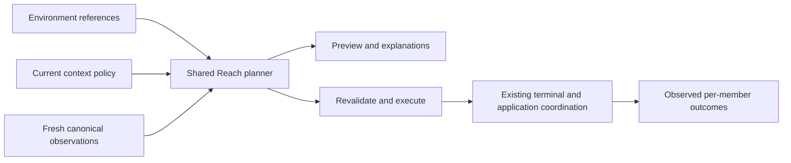

# Named work environments and reaching work

Status: design from [LAB-180](https://linear.app/riotbox/issue/LAB-180/design-named-work-environments-and-a-unified-resume-and-switch),
2026-10-15; implementation authorized on 2026-10-16 under
[LAB-375](https://linear.app/riotbox/issue/LAB-375/add-named-work-environments-and-safe-reach-in-the-existing-manager).
The first version implements definitions and Reach for existing windows. Real Sway
tests found that the generic focus-preserving launch gate below is unavailable;
all missing launches are deferred with an explicit reason. The user explicitly
selected this safe first version on 2026-10-16. Complete missing-member opening
requires a separately proven focus capability and is outside this delivery.

## First implementation

`sway-session terminal manage` retains its terminal default. Tab opens named
environments in the same manager. Create an empty definition with `n`, rename
with `e`, and use `v` to add existing terminal or application contexts and select
a primary. Each membership/primary action saves individually. Search includes
referenced context fields; missing references remain visible. `p` previews,
Enter reaches the selected primary, and `o` chooses a primary for that action
without editing the definition. `d` deletes only the definition.

Reach focuses a uniquely present active primary in place and leaves
other existing members alone, including a shared desired-closed application.
It does not open missing windows, activate archived contexts, reveal hidden
scratchpad windows or interrupt a window still in restore staging. Those cases
have individual reasons in preview and outcomes. Explicit per-context Open
retains its existing separate semantics. The
[focus investigation](research/lab-375-reach-focus-capability.md) records the
actual counterexamples and limits; the launch rows later in this design remain
requirements for a future capability, not implemented behavior.

`internal/session` owns validated definitions, coherent read snapshots and the
pure shared planner. The daemon serializes the exact-ID Reach intent and
revalidates the definition revision, context identity, canonical anchor, current
focus and live event stream before one attributed focus command. New explicit
Reach selections, unexpected focus/binding events and stream loss revoke pending
authority. Cancellation cannot undo a command Sway has already received; an
uncertain result is not automatically retried. Event drains are finite and IPC
uses the request deadline. No SQL transaction contains external calls.

The daemon adds the owner-only `sway-session/reach.sock` under
`XDG_RUNTIME_DIR`. Its version-1 request carries only an environment ID, optional
member override and compositor identity; framed results stream per member with
bounded frame sizes and worker admission. It does not change the established
session-start v1 or agent-report v2 protocols. The manager and daemon must run
the updated binary; saved definitions remain editable if Sway or Reach is
unavailable. There is no additional standalone broker command or startup rule.

### Metadata and compatibility

The first explicit environment creation atomically adds optional strict
`work_environments` and `work_environment_members` tables to `state.sqlite3`.
Read-only listing and preview do not create state or migrate an old database.
Existing database v1, context v5 and layout v2 versions remain unchanged. This
is nevertheless a real schema extension, not a promise of older-binary backup
compatibility. Malformed or incomplete extensions fail closed.

The new binary accepts old metadata/backups without definitions and includes
definitions, order, primary and unresolved references in consistent backup and
recovery. Membership references have no context-deletion cascade; only deleting
an environment cascades to its own membership rows. Revision checks and the
registry lock serialize edits with final Reach validation/effects. An uncertain
commit preserves the candidate identity and asks for inspection/refresh rather
than recreating it under a second ID.

Older binaries' strict backup validators do not recognize this extension and
can reject backup/recovery once it exists, even after the last environment is
deleted. Use the updated binary for backup/recovery. Before downgrading, retain
a pre-extension backup and understand that recovering it replaces metadata,
including later changes; it does not merge definitions into the older state.
No automatic destructive downgrade or table removal is provided.

The following sections preserve the full design and later scopes. They must be
read with the first version's explicit existing-window boundary above.

## Existing capabilities and actual gaps

The current manager already searches terminal labels, project keys, saved paths,
available pane-directory hints and IDs; preserves selection across refresh;
orders recent work; and opens an exact existing terminal context. It separately
explains window presence, Herdr state, agent evidence, next-login policy and last
restore outcome. Those observations do not prove one another.

| Proposal | Existing work to reuse | Remaining scope |
| --- | --- | --- |
| Named environments | Stable terminal/application context IDs; exact terminal reuse; canonical application groups | First slice: nonowning membership, explicit primary, search, preview and Reach |
| One manager | LAB-129 build identity, LAB-130 eligibility/preview, LAB-131 observations, LAB-132 outcomes/retry, LAB-250 app inventory | Mixed member/environment projection and navigation over those sources |
| Named layouts/templates | Current canonical capture/restore and typed empty-session Herdr initialization | Later explicit layout bookmarks and new-work templates |
| Opening on demand | Authoritative context lifecycle, app desired-open and existing bounded launch coordination | Later context-owned startup eligibility and optional group demand; no workspace-visit heuristic |
| Monitor situations | Current workspace/geometry capture; upstream output observations | Later output-role identity/fallback model and migration, independent of monitor mode configuration |
| Setup/updates/diagnostics | LAB-136 Doctor, LAB-129 explicit restart guidance, LAB-133 metadata backup/recovery | Onboarding navigation first; a separate reviewed inspect-before-export report contract later |

LAB-129/130/131/132/133/136 are all Done, verified against Linear and current
source on 2026-10-15. They must not be reopened or duplicated. Relevant modules:
[terminal manager UI](https://github.com/marang/sway-session/blob/main/cmd/sway-session/terminal_manage.go),
[terminal operations](https://github.com/marang/sway-session/blob/main/cmd/sway-session/terminal_manage_operations.go),
[restore policy](https://github.com/marang/sway-session/blob/main/internal/session/restore_policy.go),
[terminal observation](https://github.com/marang/sway-session/blob/main/internal/session/terminal_observation.go),
[restore reports/retry](https://github.com/marang/sway-session/blob/main/cmd/sway-session/restore_report_cli.go),
[app inventory](https://github.com/marang/sway-session/blob/main/cmd/sway-session/application_inventory.go),
[Doctor](https://github.com/marang/sway-session/blob/main/internal/doctor/doctor.go) and
[metadata backup](https://github.com/marang/sway-session/blob/main/cmd/sway-session/state.go).

Before LAB-375 there was no environment collection or generic mixed-context
Reach operation. Public terminal Open always requests focus. Explicit `restore UUID` can
set an application's desired-open intent and request its saved arrangement.
A loop over those commands would violate the new Reach contract. New execution
work is required; renaming existing UI actions cannot supply these semantics.

## Definitions and ownership

A **work environment** is a user-named, nonowning collection of existing context
references. It has its own stable ID, a unique exact name, ordered distinct
member IDs and an explicitly selected **primary member**. Names use the existing
presentation-text constraints, additionally require nonempty text, and remain
case-sensitive; IDs survive rename. Search can return multiple matches, but an
effect always targets an exact selected environment/context ID.

Membership is many-to-many. An environment may share one globally registered
browser with another environment. It cannot clone application identity, assign
another launcher or create a second context for that browser. Context lifecycle,
desired-open, launcher trust, Herdr ownership and current observations remain
authoritative at their existing owners.
Members reference contexts directly; environments do not nest.

- Add existing active or archived contexts through an explicit picker. Duplicate
  member IDs are invalid. Order is presentation, not an inferred focus priority.
- Removing a member or deleting an environment changes only that definition. It
  never archives, closes, forgets or purges a context or Herdr session.
- Archiving a context leaves its memberships intact. Forget/purge leaves an
  unresolved reference, visible until explicit removal or replacement; no guess
  from its old name, path or another matching application repairs it.
- Removing the primary clears that designation. Empty groups and groups without
  a primary remain editable; Reach requires the user to choose a valid primary.
- An unavailable primary has no automatic fallback. The manager offers explicit
  member selection for this action or editing the saved primary.

Definitions belong in the existing owner-only SQLite metadata store, rather
than a second mutable configuration file. This keeps manager edits and metadata
backup coherent. Store only environment identity/name, membership/order and
primary; do not copy context policy, application identity, runtime observations
or layouts. See [ADR-0002](adr/0002-nonowning-work-environments.md).

The migration must preserve existing contexts and forward compatibility, include
the definitions in LAB-133 backup/recovery validation, enforce environment-owned
member cleanup, and deliberately preserve unresolved context references. A
context deletion must not cascade into deleting environments or silently
changing their primary. Existing schema versions remain unchanged in this
implementation. No total context-count or environment/member-count ceiling is
introduced; operations use bounded resumable work instead.

Distinct Git worktrees use distinct existing terminal UUIDs or distinct project
keys and saved initial paths. Reusing one project key with a conflicting path
continues to fail. Environment selection never discovers projects, changes Git
branches, runs project hooks or rewrites the startup directory of existing work.

## Reach versus arranging windows

**Reach** is the default Open/Focus intent. It brings the explicit primary into
reach at its existing location and opens only proven-missing eligible members.
It does not apply a layout or change lifecycle intent. Existing windows stay
where the user put them; a shared browser on another workspace stays there.

| Current member facts | Reach decision |
| --- | --- |
| Active, uniquely present with a fresh canonical anchor | Focus in place if primary; otherwise leave it alone |
| Active app present but desired-open false | Same focus-only rule; never change its saved intent |
| Active terminal absent, supported adapter/coordination ready | Reuse its exact Herdr session or existing pending launch; attach/open only as needed |
| Active app absent, desired-open true, eligible and launcher valid | Request one existing coordinated launch without replaying an arrangement |
| Archived, or absent app desired-open false | Skip with the authoritative policy reason; offer separate explicit lifecycle actions |
| Missing context reference, ambiguous identity/anchor, unavailable or stale evidence | Unresolved/uncertain; do not infer absence or select a substitute |
| Reapproval, invalid launcher, unsupported adapter, missing startup path or unsafe focus capability | Block that launch and show the specific remedy; no surprise approval or fallback launcher |

Preflight the primary first. If it is unresolved, archived, ambiguous, unknown
or blocked from reaching, show the result before starting other members. The
user can explicitly select another primary for this action. If it is eligible
but absent, start it first and await a unique mapped anchor within the existing
coordinator's bounds before admitting background members. Failure preserves
the conservative launch guard; it does not trigger blind retries.

New windows use existing per-context placement decisions in placement-only
mode; membership adds no destination or layout authority. Existing windows
receive no move/layout commands. A shared missing application is still one
global context and one coordinated launch, whichever environment requested it.
Reaching an already running terminal never reinitializes its Herdr panes.

### One decision path for preview, execution and explanations

Place the Reach module at the existing session orchestration seam. Its small
interface provides preview of an environment intent and execution of that same
intent; callers supply an exact environment ID and optional explicit primary
override. They do not supply shell commands, guessed window IDs or a trusted
previously generated plan. TUI and any future CLI adapter consume the same
typed per-member decisions, reasons and outcomes.



Execution resolves the current definition and fresh facts again. Before each
effect it rechecks context revision, policy, presence, exact anchor, launcher
trust, environment revision and compositor identity. Definition edits or deletion
invalidate unstarted effects from that definition. A changed plan yields an
explicit changed/skipped
result; preview is never permission to replay stale effects. Existing launch
claims, ambiguity handling, locks and retryable sagas remain authoritative.
SQLite transactions stay short and contain no Sway, Herdr, process or launcher
calls. Large groups yield through bounded fair work and fresh observations.

Repeated/concurrent selection coalesces by stable context identity and existing
coordination; it cannot create a context or a second launch coordinator.
Reports distinguish focused, already present, opening/pending, skipped,
uncertain and failed. Partial success does not imply every member is open.
Already started work is not closed as rollback when another member fails.

### Focus authority and capability gate

The latest explicit selection owns one ephemeral focus intent for that
compositor. A new selection supersedes older pending focus and unstarted work.
An unexpected user focus change revokes pending focus authority; late arrivals
must not pull the user back. There is no silently persisted active environment
that moves shared windows to keep a group visually complete.

`Focus=false` alone does not establish this guarantee: a compositor/app can
focus a newly mapped window independently. The first implementation must prove
a focus-preserving launch adapter with real disposable Sway, including the user
switching elsewhere after process start. Unknown or unsupported safe launch
capability means defer that group launch with an explicit reason; an already
reachable primary can still be focused. Choosing another primary or per-member
Open remains explicit. Do not silently call today's
always-focus terminal Open or claim background launch succeeded.

This is a capability gate for missing-member opening, not an assertion that the current
interface already supports it. Before that gate passes, the slice cannot claim
complete missing-member opening. User-initiated per-member Open remains a
distinct focus-authorizing action with its existing semantics.

## One manager interaction

Extend the current manager model and observations rather than adding a separate
status engine. Preserve the current terminal entry point/default and keyboard
behavior. Add an environment view and mixed member details using the same
controller; any additive unified entry point needs an explicit compatibility
decision in the implementation issue. This design adds no current CLI syntax.

Search covers environment name and referenced contexts' existing searchable
fields. Selection remains bound to stable IDs across filtering, rename and
refresh. Definition editing uses pickers over existing contexts, including an
explicit primary selector. Enter means Reach; Details, Preview, editing and
existing lifecycle/retry actions stay discoverable and separate.

Illustrative detail content, not current output:

```text
sway-session development
Primary: agent and shell

agent and shell    Window present · workspace 98
                  Herdr running · Agent unknown
                  At login: eligible · Last restore: completed
shared browser    Window present · workspace 99
                  At login: desired closed
review terminal   Archived · omitted from Reach

Reach     Preview     Members     Details
```

Keep Window, Herdr, Agent, policy/reason and restore proof as separate facts.
Application members have no Herdr/agent session fact; this is not an unknown
terminal observation. A saved agent association never becomes “agent running”.
Loading/unavailable evidence remains explicit, and fresh observations must not
block search or rewrite saved startup paths.

Text entry owns ordinary typing; modal/picker input precedes global shortcuts.
Escape returns without discarding an existing search or changing definitions.
Use the existing help/action model instead of inventing conflicting keys here.
At narrow terminal sizes, show a compact row and scrollable details; preserve
selected IDs and partial results through refresh. Distinguish failure/unknown
with text rather than color alone. No visual usability run is claimed by this
planning document.

## Later features and precedence already chosen

**Startup policies.** Slice one adds none. Current context eligibility stays
authoritative. A later environment mode contributes demand when its trigger
occurs; multiple triggered groups combine positive demand for a shared context
and deduplicate it. A manual-only group contributes no automatic demand and
does not veto another group or direct context policy. Archive and app
desired-closed remain hard exclusions. Today's active terminals are automatically
eligible: making an active context manual-only needs a dedicated context-owned
eligibility change, not another copied lifecycle bit in a group. These changes
must share the current evaluator and reasons; no workspace-visit heuristic.

**Last used, named layout and template.** Automatic capture remains last used.
A later named layout is a deliberately saved bookmark with its own stable
identity/revision, references and preferred arrangement; ordinary capture cannot
overwrite it. Explicit preview/apply can move a shared context away from another
environment only as a visible operation on the chosen bookmark. Duplicate
placements for one context are invalid. Archived, desired-closed, missing or
ambiguous members stay omitted/degraded with reasons; old bookmarks cannot
reactivate them. Applying a layout never closes unreferenced work. A template
describes new contexts and initialization of new empty sessions; it never clones
live Herdr panes, terminal history, browser tabs or agent conversations.

**Output roles.** Later preferred/fallback placement needs explicit role
assignment and validated observations. The pinned [Sway GET_OUTPUTS contract](https://github.com/swaywm/sway/blob/1652c54b73f67df17b7b4ab0b0f7048204aa8104/sway/sway-ipc.7.scd#L187)
documents name, make/model/serial, scale, transform, active state and current
workspace. Its `primary` field is always false; it cannot select a primary role.
Current project IPC types/subscriptions and layout model do not yet expose a
complete output-role/hotplug capability. No physical monitor test is claimed.
Missing/ambiguous preferred outputs cannot overwrite the bookmark. Use an
explicit accessible fallback or request a choice; on reconnect offer explicit
restoration, never automatically move existing windows. Resolution, refresh
rate and general monitor configuration remain in Sway configuration.

**Setup, diagnostics and backup.** Guide create → name → explain policy → reopen
through existing operations and Doctor. Introduce agent roles/apps/groups only
when needed; never restart existing work automatically. Any future local export
starts with versions, capability/result codes and aggregate structural counts
only. Omit labels, directories, context IDs, workspace/output names and serials,
raw trees, arguments, environment and pane/app content. The user inspects the
actual payload locally and chooses whether to export it. Counts and unusual
version combinations can still identify a workstation; removing names is
redaction, not guaranteed anonymity, and hashing identifiers does not remove
linkability. No automatic telemetry, secrets or app session payloads.
Group/bookmark metadata joins existing consistent backup; backup is
not a browser/session-content or named-layout feature by itself.

## First implementation slice and behavioral acceptance

LAB-375 covers **named membership plus Reach in the existing manager**:
definitions/editing/search, primary selection, shared preview/execution,
per-member outcomes, migration/backup compatibility and the focus capability
gate, with the approved existing-window delivery boundary recorded above. It
excludes favorites, new startup modes, named-layout application,
templates, output roles and diagnostic export. No placeholder/duplicate issues
are created by this design. Later features above are bounded follow-up scopes,
not additions to the next consolidated release.

| Scenario | Required future evidence |
| --- | --- |
| Repeated and concurrent Reach | Same context IDs, one coordinated start/attachment per missing member, latest focus intent wins |
| Two environments share a browser | Existing window stays on its workspace; simultaneous missing requests coalesce; no cloned app identity |
| Separate Git worktrees | Distinct contexts retain their initial paths; conflicting reused project key fails; no branch switch |
| Archive, desired-closed, removed or missing primary/member | No implicit activation or intent change; unresolved references visible; explicit primary choice and safe partial outcome |
| Ambiguous, stale, offline or incompatible evidence; changed/deleted definition | No guessed anchor or launch from unknown; typed reason; revision revalidation cancels unstarted stale effects |
| Primary or background launch failure | Existing launch guard retained, no blind retry, no destructive rollback or Herdr reinitialization |
| Existing windows and later arrivals | No implicit move/layout; real focus-on-map and user-switch race tests; unsupported capability defers launch |
| Rename/filter/refresh/narrow terminal/input mode | Stable selection, no stolen text input, visible contextual help, preserved search, text-based unknown/failure feedback |
| Persistence and backup | Reopen/rename/delete roundtrip; unique references/primary invariants; unresolved-reference preservation; old-schema and backup compatibility; no external calls in transactions |
| Later explicit named layout | Preview equals revalidated effects; shared moves visible; archived/closed omissions; unreferenced windows remain; capture cannot overwrite bookmark |
| Later output loss/reconnect | Validated or explicit role choice; accessible fallback; preferred bookmark unchanged; explicit restoration only |

Use deterministic planner/decision tests and behavioral CLI/TUI tests. Prove
actual focus/placement/concurrency with disposable state and workspace 98+.
An implementation is complete only when its real capability and compatibility
gates pass; a prose design or synthetic test cannot stand in for those runs.
